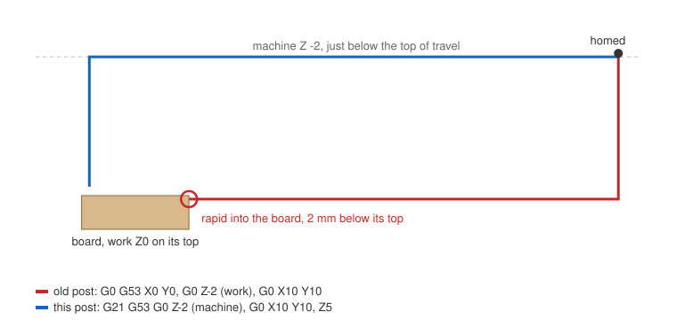
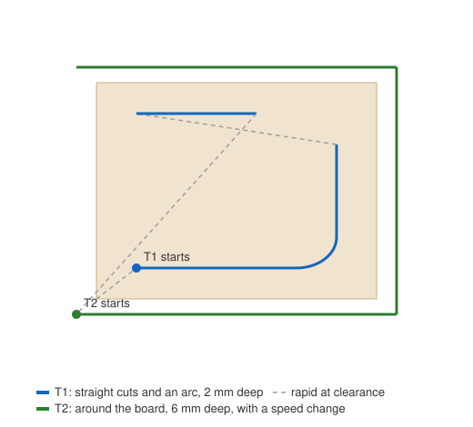

# solidworks-cam-grbl-post

A SOLIDWORKS CAM / CAMWorks post processor for Grbl 1.1 and grblHAL routers,
such as the Sienci LongMill (the LongBoard runs Grbl 1.1, the SuperLongBoard on
the MK2.5 runs grblHAL). It writes only G-code both controllers accept, and it
retracts to the top of Z travel in machine coordinates before every tool change
and at the end of the job. `tools/check_gcode.py` checks a posted file before it
reaches the machine.



The post this replaces wrote `G53` on a line of its own and `G0 Z-2` on the
next. `G53` applies only to the line it is on, so the `Z-2` ran in work
coordinates: 2 mm below the top of the board. With `G0 G53 X0 Y0` written
before it, the first rapid to the start of the job then crossed the board at
that height. This post writes `G21 G53 G0 Z-2`: 2 mm below the top of travel
in millimetres whatever the job's units, which it restores on the next line.

## What it writes

The start, the change to the second tool and the end of a two-tool job, as
`tests/render_post.py` renders them from `GRBL.SRC`:

```gcode
( MACHINE=LongMill )
( CONTROLLER=Grbl 1.1 or grblHAL )
G90 G94 G17 G21 G80
G21 G53 G0 Z-2
G21
(T1 6.35 MM FLAT END MILL)
M6 T1
G54
S18000 M3
G4 P3
G54 G0 G90 X10 Y10
Z5
G1 Z-2 F300
...
G0 Z25
G21 G53 G0 Z-2
G21
M5
(T2 3.175 MM FLAT END MILL)
M6 T2
G54
S12000 M3
G4 P3
...
G0 Z25
G21 G53 G0 Z-2
G21
M5
G53 G0 X0 Y0
M30
```



| | Grbl 1.1 | grblHAL |
| --- | --- | --- |
| Tool change | `M6 Tn`: gSender turns it into a comment and runs its tool change. With gSender's "passthrough" on, or another sender, Grbl rejects it | `M6 Tn`, handled by gSender as on Grbl; with passthrough on, `$341` decides |
| Spindle | `M3`/`M4` with `S`, then `G4 P3` to spin up; `M5` before a tool change and at the end | the same |
| Drilling | Choose long-code drilling in CAMWorks: Grbl has no canned cycles and rejects `G81` and the rest | `G73`, `G81` to `G86` and `G89` run; `G74`, `G87` and `G88` are rejected, and `G76` is grblHAL's lathe threading cycle, not fine boring |
| Cutter compensation | Use computer compensation: Grbl rejects `G41`/`G42` | the same, unless built with cutter compensation |
| Coolant | none written | none written |

The machine must be homed, so that machine Z0 is at the top of travel, and the
job uses work offsets `G54` to `G59`.

## Install

1. Copy `GRBL.SRC` and `GRBL.LIB` into a folder four levels below the drive
   root, such as `C:\CAMWorksData\UPG-2\Posts\GRBL\`: the source finds UPG-2's
   master library at `..\..\..\..\CAMWorksData\UPG-2\MasterLibraryFiles\MILL.LIB`.
2. Open `GRBL.SRC` in UPG-2 and compile it. UPG-2 writes `GRBL.ctl` to its
   `ctl` folder, `C:\CAMWorksData\UPG-2\ctl\` by default.
3. In CAMWorks or SOLIDWORKS CAM, select `GRBL.ctl` under Machine, Post
   Processor, in the NC Manager.
4. Post a part and check it before it runs:

   ```sh
   python3 tools/check_gcode.py --controller grblhal part.nc   # or --controller grbl
   ```

   It prints one line per problem and exits 1, or prints `ok` and exits 0.

## Checks

`just test` runs `tests/test_post.py`, which needs only Python 3. It checks
that:

- `GRBL.SRC` is laid out as UPG-2 writes it: CRLF line endings, every section
  closed, no blank or stray lines in one, every template line ending in `<EOL>`;
- every template tag already compiled in an earlier UPG-2 post, apart from
  `<#:POST_DWELL>`;
- a two-tool job rendered from the templates passes the checker for both
  controllers; a canned drilling cycle passes for grblHAL and fails only on
  `G81` for Grbl; on an inch job each retract is in millimetres with `G20`
  restored after it; and a spot-drill dwell is written in seconds;
- the checker flags each of its rules on a short program that breaks it,
  including both retracts of the post this one replaces.

The renderer models what UPG-2 compiles; it is not UPG-2. `just images` draws
the pictures.

## Where it came from

This post replaces a fork of
[msbealo/GRBL-Post](https://github.com/msbealo/GRBL-Post) (2021, built for an
RS-CNC32 on Grbl 0.9j). The declarations that make up most of `GRBL.SRC` and
all of `GRBL.LIB` (operation lists, word formats, G and M code tables) are the
ones UPG-2 writes for a Fanuc-style mill; the output templates are written
here. [Expatria-Technologies/GRBL-Post](https://github.com/Expatria-Technologies/GRBL-Post)
put `G53` and `Z-2` on one line for grblHAL in 2021, and
[euler357/Solidworks_Cam_Post](https://github.com/euler357/Solidworks_Cam_Post)
reported the old post's `Z -2`.

The lists of codes each controller accepts in `tools/check_gcode.py` come from
the parsers: `grbl/gcode.c` in gnea/grbl at bfb67f0, and `gcode.c` in
grblHAL/core at 3282140.

## Licence

MIT; see [LICENSE](LICENSE).
